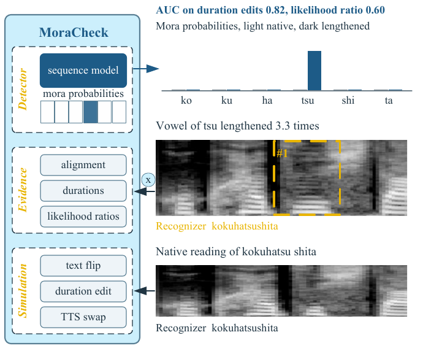

# MoraCheck

Detecting mispronounced Japanese morae in learner speech with native speech and simulated errors.

Yan Li (Bengbu University) and Xubo Fang (Kanazawa University)



## Highlights

- MoraCheck detects mispronounced Japanese morae without labelled learner speech.
- Three simulators create the training errors on native speech: text flips, duration edits calibrated to native
  category durations, and TTS swaps that a phoneme recognizer verifies.
- A frozen native phoneme recognizer supplies forced alignment, normalized durations and likelihood ratios of
  catalogue errors; a small sequence model learns which evidence to trust for each mora.
- A native recognizer hears most lengthened vowels and added geminates as the target word. MoraCheck detects them.

## Results on native validation speakers

Utterance AUC on 1,864 Common Voice speakers not seen in training. MoraCheck is the mean over three seeds.

| Validation set | MoraCheck | Cross-attention detector | Likelihood ratio | GOP | Free recognition |
|---|---|---|---|---|---|
| Text flips (2,000) | **0.964** | 0.715 | 0.950 | 0.862 | 0.717 |
| Lexical flips (1,500) | **0.954** | 0.704 | 0.952 | 0.853 | 0.724 |
| Duration edits (1,396) | **0.825** | 0.626 | 0.597 | 0.549 | 0.565 |
| TTS swaps, held-out voice (1,201) | **0.992** | 0.733 | 0.828 | 0.571 | 0.664 |

The TTS swaps were verified by the same recognizer that the baselines use, which favors the likelihood ratio on that set.
Per-type results, the recognizer outputs on duration edits and the ablations are in `results/`.

## Ablation

Utterance AUC, seed 0, 12,000 steps each.

| Variant | Flips | Lexical flips | Duration edits | TTS swaps |
|---|---|---|---|---|
| MoraCheck (seed 0) | 0.966 | 0.954 | 0.825 | 0.993 |
| without likelihood ratios | 0.954 | 0.939 | 0.814 | 0.988 |
| without durations | 0.965 | 0.952 | 0.819 | 0.992 |
| without segment features | 0.966 | 0.966 | 0.750 | 0.975 |
| without cross-attention | 0.962 | 0.949 | 0.823 | 0.992 |
| text flips only | 0.983 | 0.980 | 0.630 | 0.842 |
| without TTS swaps | 0.970 | 0.959 | 0.834 | 0.824 |
| without duration edits | 0.980 | 0.977 | 0.644 | 0.994 |
| without text flips | 0.799 | 0.776 | 0.789 | 0.979 |

Each simulator is needed for its own error kind, and the segment features carry the duration errors. Over three seeds, duration-edit AUC was 0.736 without segment features and 0.645 without duration edits, and flip AUC was 0.722 without text flips (`results/seed_summary.json`). A control with fixed duration factors near 0.5 and 2.0 instead of calibrated targets reached 0.805 on duration edits.

## Installation

```bash
python3.12 -m venv .venv && . .venv/bin/activate
pip install torch==2.7.1 torchaudio==2.7.1 --index-url https://download.pytorch.org/whl/cu128
pip install -r requirements.txt
```

Models from the Hugging Face Hub, placed in `models/`:

```bash
huggingface-cli download prj-beatrice/japanese-hubert-base-phoneme-ctc-v4 --local-dir models/japanese-hubert-base-phoneme-ctc-v4
huggingface-cli download yky-h/japanese-hubert-base --local-dir models/japanese-hubert-base
```

Kokoro-82M and its Japanese voices are downloaded on first use.

## Data

Run every script from the repository root.

1. JSUT 1.1 into `data/raw/jsut_ver1.1/` and jsut-label into `data/raw/jsut-label/`
   (https://sites.google.com/site/shinnosuketakamichi/publication/jsut, https://github.com/sarulab-speech/jsut-label).
2. Common Voice 17.0 Japanese and FLEURS ja_jp: `python scripts/dl_corpora.py`.
3. Manifest, CTC alignment and filtering:

```bash
python scripts/build_native_manifest.py          # data/native.jsonl, 16 kHz wavs
python scripts/ctc_align.py                      # data/native_aligned.jsonl
python scripts/check_align_jsut.py               # boundary accuracy on JSUT, writes data/native_clean.jsonl
```

4. Simulated data and validation sets:

```bash
python scripts/make_val_flip.py
python scripts/make_val_lex.py
python scripts/make_dur_edits.py valid 1 data/sim/val_dur 1500
python scripts/make_dur_edits.py train 1 data/sim/dur_train
python scripts/make_tts.py valid 600 data/sim/val_tts
python scripts/make_tts.py train 4000 data/sim/tts_train 1
```

UME-JRF, the rated learner speech used for the final evaluation, is available on application from the NII
Informatics Research Data Repository (DOI 10.32130/src.UME-JRF). It cannot be redistributed.

## Training and evaluation

```bash
python scripts/train_v2.py --name moracheck_s0 --sources flip,dur,tts --seed 0
python scripts/eval_val.py results/runs/moracheck_s0/best.pt
python scripts/baselines.py data/sim/val_flip.jsonl data/sim/val_lex.jsonl data/sim/val_dur.jsonl data/sim/val_tts.jsonl
python scripts/table_ablation.py
```

`scripts/runs.txt` lists every training run of the paper, including the seeds, the ablations and the
cross-attention detector. Each run takes about 90 minutes on one RTX 5070 with 12 GB of memory and uses at most
5.5 GB (`--gpu_gb`). For rated learner speech, `scripts/eval_target_words.py` scores the rated words and
`scripts/umejrf_analyze.py` computes speaker-cluster bootstrap intervals and agreement with the teachers.

## Directory

```
scripts/   data preparation, simulators, detectors, baselines, evaluation
results/   result summaries of the paper (JSON)
```

## License

Code: MIT ([`LICENSE`](LICENSE)). Result summaries and the figure: CC BY 4.0. Corpora remain under their own terms
([`DATA_LICENSE.md`](DATA_LICENSE.md)).
